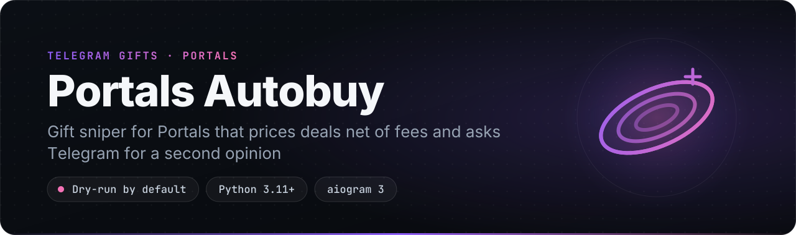
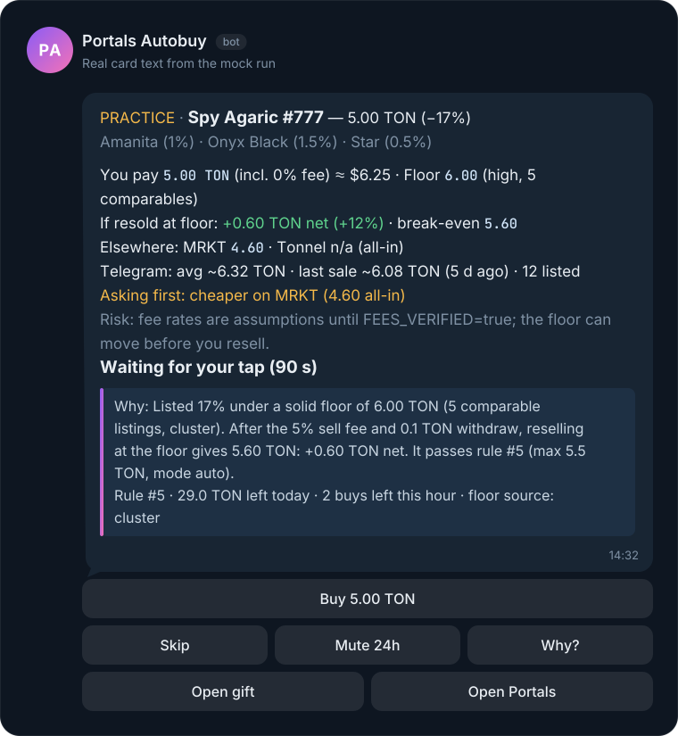
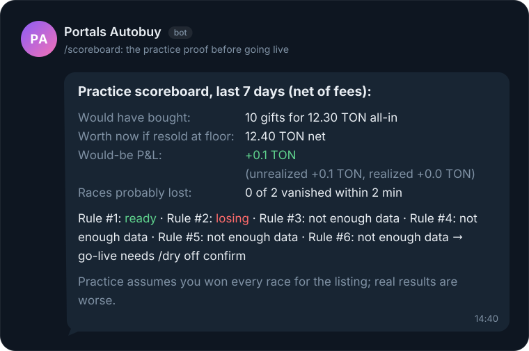
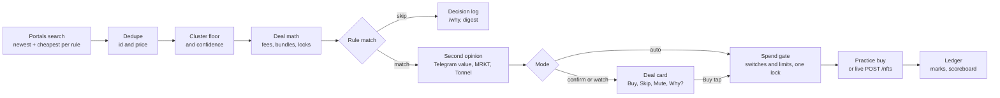

<p align="center">
  
</p>

<p align="center">
  
  
  
  
  
  
  
  
</p>

<p align="center">
  <b>A self-hosted Telegram gift sniper for Portals that shows what you keep after fees and checks the price with Telegram before it buys.</b><br>
  <a href="#features">Features</a> · <a href="#quick-start">Quick start</a> · <a href="#commands">Commands</a> · <a href="#how-it-works">How it works</a> · <a href="#safety">Safety</a> · <a href="#roadmap">Roadmap</a>
</p>

Portals Autobuy watches the [Portals](https://t.me/portals) marketplace for Telegram gifts that match your rules. It sends you a deal card for each one and, if you allow it, buys. Alert feeds and fast snipers stop at "X% under the floor". This bot works out what you actually keep after fees, how solid that floor is, and whether the gift is locked or part of a bundle. Before it spends, it checks the price against Telegram's own valuation and against other markets.

It starts in practice mode, so you see what it would have made before you risk real TON. Live mode lasts 24 hours at a time, within hard limits, and `/panic` stops it at once. It runs on your server, your Telegram account and your Portals balance: no deposits, no shared sessions, no closed binaries.

> **Status: alpha.** The full pipeline runs offline in `mock` mode and in 277 tests. Portals' public endpoints (search, collections, floors) were checked live, and `floors` and `once` ran against the live API in practice mode on 2026-10-28. The buy and balance calls come from a community client and have never run with a real account. Read [Before going live](#before-going-live) first.

## Why it's different

- **Profit after fees, not discount to floor.** Every card shows the all-in cost, what a resale at the floor leaves you after the sell and withdrawal fees, and the break-even price. A deal that loses money after fees is skipped, however big the discount looks. Collections that Portals marks `zero_commission` get a 0% sell fee automatically. Bundles are blocked, and a gift you cannot resell for days is skipped unless your rule accepts the lock.
- **A floor you can trust, with a confidence level.** One seller with two cheap listings can fake a "second-cheapest" floor. This bot uses a cluster floor: the lowest ask with at least two other asks within 10% above it. Each floor is labeled `high`, `med` or `low` by the listings that back it. Without a cluster of at least three it is `low`, which the default rule (`min_confidence=med`) never buys and which triggers the Telegram check. A floor also drops a level when it moves more than 25% within an hour.
- **A second opinion before it spends.** It looks up Telegram's own valuation of the exact gift (`payments.getUniqueStarGiftValueInfo`, which none of the snipers we reviewed use) and the same gift's floor on MRKT and Tonnel, read from floor files that bots for those markets write. If the gift is cheaper elsewhere, or priced above both Telegram's average and last sale on a `low`-confidence floor, the bot asks you instead of buying.
- **It proves itself in practice before it touches your money.** Practice buys are marked against the floor and reported net of fees in `/scoreboard`, which also counts races you probably lost. Each rule gets a verdict: `ready`, `losing` or `not enough data`. Live mode turns itself off after 24 hours.
- **Non-custodial, open, and no login needed to practice.** Custodial sniper bots ask for a TON or Stars deposit. This one runs on your machine with your account. Portals search and floors are public, so practice mode needs only a bot token. Every decision, including each skip, is logged, and `/why` explains it in plain words.

## Features

| | Feature | What you get |
|---|---|---|
| 🎯 | **Rule-based sniping** | Rules by collection, model, backdrop and symbol, with a max price (fees included), min discount, min profit in TON or %, min floor confidence and a lock tolerance. Each cycle, 2 s apart by default, scans the newest listings across your collections and the cheapest listings per rule. |
| 🧮 | **Net-of-fees math** | All-in cost, net exit at the floor, profit in TON and %, and the break-even price on every card, plus an optional USD amount. |
| 📉 | **Honest floor** | A cluster floor with `high`/`med`/`low` confidence and floor snapshots over time. Without a cluster it uses the median of the three cheapest other listings, marked as thin and rated `low`. With no comparable listing, it falls back to the model or symbol floor, then the collection floor. |
| 🪤 | **Trap filter** | Bundles are blocked and excluded from search. Locked gifts (`unlocks_at` in the future) are skipped unless a rule allows the lock. A price under 25% of the floor is never auto-bought. Unknown price units are refused. |
| 🃏 | **Deal cards** | Per-rule mode: `auto`, `confirm` or `watch`. Buttons for Buy, Skip, Mute 24h and Why?. Each card lists the model, backdrop and symbol with their rarity. The price is re-checked before a tap buys, cards expire after 90 s, and a double tap is safe. |
| 🤏 | **Near-miss nudges** | A silent card when exactly one check misses by 5% or less, with a one-tap "Raise max" (at most 3 an hour). |
| 🔍 | **Second opinion** | Telegram's valuation (average, last sale, listed count), MRKT and Tonnel floors from snapshot files, and `/compare` across markets, all-in and net. |
| 🧪 | **Practice first** | A practice ledger with marks, `/pnl`, `/scoreboard`, per-rule verdicts, CSV export, and a live gate that expires after 24 h. |
| 🛡️ | **Safety envelope** | `/safety`, `/panic`, limit presets that never go above `.env`, and breakers for a floor crash, a losing streak, a balance mismatch and repeated failed buys. |
| 🪄 | **`/hunt` wizard** | Set up a rule in five steps with buttons, or paste a `t.me/nft/...` link. Before you save, it shows what the rule would have caught in the last 24 h. |
| 🌓 | **Shadow rules** | New rules, from the bot or `rules.json`, start in shadow (practice only, even in live mode). A hindsight card offers to promote them once they have enough data. |
| 🧾 | **Explained decisions** | Every evaluation goes to a `decisions` table and `data/events.jsonl`. You also get `/why`, an optional daily digest with tuning hints, and an optional "Explain more" button that uses Claude. |
| 🩺 | **`/doctor`** | Checks bot config, Telegram session, 2FA, session file permissions, Portals auth, reachability, clock skew, the engine, rules, fees, peers, database and limits, with a fix for each failing item. |

## See it in action

<p align="center">
  
</p>

The rule is in `auto` mode and the deal is +0.60 TON net after fees, but the same gift costs less on MRKT, so the bot asks first instead of buying.

An excerpt of `python -m portals_autobuy mock --cycles 2`, which runs offline with fixture data and no keys:

```text
MOCK mode: 6 demo rules, 2 cycle(s), PRACTICE forced (DRY_RUN lock), tap=none
  ...
  Fees: buy 0% · sell 5% · withdraw 0.1 TON (unverified)

--- cycle 1 ---
[notify] DEAL Lunar Snake #4410 1.00 TON · floor 1.60 (cluster, 4 comparables, high) · you pay 1.00 incl. 0% fee · resold at floor: +0.42 TON net (+42%) · break-even 1.42
  PRACTICE · Lunar Snake #4410 — 1.00 TON (−38%)
  Albino (1.5%) · Onyx Black (2%) · Star (0.8%)
  You pay 1.00 TON (incl. 0% fee) ≈ $1.25 · Floor 1.60 (high, 4 comparables)
  If resold at floor: +0.42 TON net (+42%) · break-even 1.42
  Elsewhere: MRKT 1.75 · Tonnel n/a (all-in)
  Telegram: avg ~2.00 TON · last sale ~1.92 TON (3 d ago) · 41 listed
  ...
  PRACTICE: would buy
  ...
[notify] NEAR MISS PRACTICE · Desk Calendar #3001 — 2.62 TON (−18%)
  Missed by a hair: 2.62 TON, your max is 2.50
  ...
[notify] DEAL Homemade Cake #1234 3.00 TON · floor 4.00 (thin, 1 comparable, low) · you pay 3.00 incl. 0% fee · resold at floor: +0.70 TON net (+23%) · break-even 3.70
  ...
  Asking first: above Telegram's last sale (2.60 TON)
  Risk: thin floor, only 1 comparable listing.
  ...
cycle 1/2: fetched=30 new=30 matched=5 rejected=25 bought=0 dry=1 cards=4 skipped=0 failed=0 · requests=9
  skip #4412 0.97 TON: loses 0.12 TON after fees (rule #2)
  ...
  skip #54 1.10 TON: a bundle, not a single gift (rule #4)
  skip #53 1.20 TON: locked: unlocks in 6 d (rule #4)
  ...

--- /scoreboard ---
Practice scoreboard, last 7 days (net of fees):
Would have bought: 10 gifts for 12.30 TON all-in
Worth now if resold at floor: 12.40 TON net
Would-be P&L: +0.1 TON (unrealized +0.1 TON, realized +0.0 TON)
Races probably lost: 0 of 2 vanished within 2 min

--- summary ---
client.buy() calls: 0 (practice never buys)
skip reasons: OVER_MAX 16 · LOW_CONFIDENCE 6 · LOSES_AFTER_FEES 1 · TRAP_BUNDLE 1 · LOCKED 1 · ABOVE_TG_VALUE 1 · CHEAPER_ELSEWHERE 1 · TOO_GOOD 1
```

The mock run also prints `/pnl`, `/score`, the `/dry off` gate, `/why`, the digest, `/safety`, `/peers` and `/compare`. Extra flags show the other paths. `--tap buy` covers the re-check before a tapped buy, double taps and the hourly cap. `--crash` fires the floor-crash breaker. There are also `--panic`, `--preview "<rule>"`, `--doctor` and `--shadow-hours 0`. For example, `mock --tap buy --crash` prints these lines among others:

```text
[tap buy] price changed 2.20 → 2.40, not bought
[tap buy] double tap on the same card: Expired or already handled
[notify] Rule #2 paused for 60 min: floor −30% in 1 h
```

<p align="center">
  
</p>

## Quick start

1. **Try it with zero keys.** Clone, install, and run the offline mock. You need Windows 10/11 (x64) with Python 3.11 or newer. Replace `SilentOverlordBrace` with the GitHub account that hosts this repository, or copy the URL from its **Code** button.

   ```powershell
   git clone https://github.com/SilentOverlordBrace/portals-autobuy.git
   ```
   ```powershell
   cd portals-autobuy
   ```
   ```powershell
   py -3 -m venv .venv
   ```
   ```powershell
   .venv\Scripts\pip install -r requirements.txt
   ```
   ```powershell
   .venv\Scripts\python -m portals_autobuy mock --cycles 2
   ```

2. **Create your bot.** In Telegram, open [@BotFather](https://t.me/BotFather), send `/newbot`, choose a name and a username, and copy the token it gives you. That token is `BOT_TOKEN`.

3. **Find your numeric Telegram ID.** Send any message to [@userinfobot](https://t.me/userinfobot). It replies with your `Id`, which goes in `ADMIN_IDS`. Only these IDs can use the bot and its buttons. Separate several IDs with commas.

4. **Configure `.env`.** Copy the example, then set `BOT_TOKEN` and `ADMIN_IDS`. Leave `DRY_RUN=true`. Times are shown in UTC unless you set `TZ_OFFSET_HOURS` to your offset (for example `3` for Moscow). This is all practice mode needs, because Portals search and floors are public. Open your bot in Telegram and press **Start** once, so it is allowed to message you. From then on, `mock` sends its demo cards to your chat instead of printing them. The buttons on those cards do nothing, because `mock` does not run the bot.

   ```powershell
   copy .env.example .env
   ```

5. **Optional now, required for live mode: log in to Telegram.** Sign in at [my.telegram.org](https://my.telegram.org), open *API development tools* and create an app. Put `api_id` and `api_hash` in `TG_API_ID` and `TG_API_HASH`. The bot uses them to open the Portals Mini App as you, which is how Portals authenticates buys and `/balance`. The same session turns on Telegram's valuation on deal cards and link lookup in `/hunt`. The login asks for your phone number, the login code and your 2FA password if you have one. It saves the session to `data/portals.session` (mode 600) and checks that it can get Portals `initData`.

   ```powershell
   .venv\Scripts\python -m portals_autobuy login
   ```

6. **Check the setup.** Each failing item comes with a fix, and the exit code is 1 if anything fails. If you skipped step 5, the Telegram session check fails; that is expected while you stay in practice.

   ```powershell
   .venv\Scripts\python -m portals_autobuy doctor
   ```

7. **Run it.**

   ```powershell
   .venv\Scripts\python -m portals_autobuy run
   ```

8. **Add your first rule.** In your bot, send `/start`. It says in a few lines what the bot does, shows the mode and limits, and names three commands to try first (`/hunt`, `/scoreboard`, `/doctor`). With no rules yet, it then opens the `/hunt` wizard. Watch `/scoreboard` for a few days before you consider live mode.

## Self-hosting

The bot is a single Python process with a SQLite database in `data/`. It needs no inbound ports, because it polls Telegram and Portals.

### Windows

This is a Windows build: install it on Windows 10/11 (x64) with Python 3.11 or newer from [python.org](https://www.python.org/downloads/windows/) (tick *Add python.exe to PATH*). The CLI refuses to start anywhere else (`This build is Windows-only.`), because the packaged companion runtime is a Windows program.

1. Get the code and set up a virtual environment:

   ```powershell
   git clone https://github.com/SilentOverlordBrace/portals-autobuy.git
   cd portals-autobuy
   py -3 -m venv .venv
   ```

2. Install, configure, log in and check, as in Quick start steps 4-7:

   ```powershell
   .venv\Scripts\pip install -r requirements.txt
   ```
   ```powershell
   copy .env.example .env
   ```
   ```powershell
   .venv\Scripts\python -m portals_autobuy login
   ```
   ```powershell
   .venv\Scripts\python -m portals_autobuy doctor
   ```

3. Start it, and keep it running. The bot runs in the window you start it from; close the window and it stops. To start it with the machine, register it with Task Scheduler:

   ```powershell
   .venv\Scripts\python -m portals_autobuy run
   ```
   ```powershell
   schtasks /Create /TN "portals_autobuy" /TR "cmd /c cd /d %USERPROFILE%\portals-autobuy && .venv\Scripts\python -m portals_autobuy run" /SC ONLOGON
   ```
Install on Windows only: there is no Docker image and no Linux service file in this release.

### Free by default

Everything in this repo works without paid API keys.

| Key | Required? | Where to get it | Cost |
|---|---|---|---|
| `BOT_TOKEN` | Yes, for the admin bot. Without it, `run` prints alerts to stdout | [@BotFather](https://t.me/BotFather) → `/newbot` | Free |
| `ADMIN_IDS` | Yes, with `BOT_TOKEN` | [@userinfobot](https://t.me/userinfobot) shows your numeric ID | Free |
| `TG_API_ID`, `TG_API_HASH` | No for practice. Yes for live buys and `/balance`. They also enable Telegram's valuation and `/hunt` link lookup | [my.telegram.org](https://my.telegram.org) → API development tools | Free |
| `PORTALS_INIT_DATA` | No | Mini App `initData` pasted by hand, as an alternative to Telethon. It cannot refresh itself | Free |
| `HTTP_PROXY` | No | Any HTTP proxy, if Portals rate-limits your IP | Your proxy provider's price |
| `TON_RATE_URL` | No (preset) | tonapi.io public rates endpoint, no key | Free |
| `PEER_FLOOR_FILES` | No | Floor snapshot files written by other bots you run, such as MRKT or Tonnel snipers (schema below) | Free |
| `ANTHROPIC_API_KEY` | No (also needs `pip install anthropic`) | [console.anthropic.com](https://console.anthropic.com) | Paid per use. Without it the "Explain more" button is hidden and no call is made; `/why` works without it |

Live buying needs TON on your Portals balance. Practice mode needs none.

## Configuration

All settings live in `.env`. If a value is invalid, the command stops with one line that names the key, for example `Error: invalid value in .env: MAX_PRICE_TON: Input should be a valid number, unable to parse string as a number`. Numbers must be finite: `nan` and `inf` are refused, because a NaN limit would never block a buy.

| Key | Default | Meaning |
|---|---|---|
| `DRY_RUN` | `true` | Hard practice lock. While it is `true`, no bot command or stored setting can turn on live mode. |
| `MAX_PRICE_TON` | `10` | Max all-in cost of one gift, fees included. Caps every rule. |
| `DAILY_BUDGET_TON` | `30` | Spend limit for a rolling 24 hours, all-in. |
| `MAX_BUYS_PER_HOUR` | `3` | Max buys in the last hour. |
| `LIVE_ARM_HOURS` | `24` | How long live mode stays on, once armed, before it reverts to practice. |
| `CONFIRM_ABOVE_TON` | `0` | Buys above this always ask first, even in `auto`. `0` means half of the max price in force: `MAX_PRICE_TON`, or a lower `/preset` max. |
| `SELL_FEE_PCT` | `5` | Assumed Portals sell fee. `zero_commission` collections use 0%. `WITHDRAW_FEE_TON` (`0.1`) is also counted. |
| `FEES_VERIFIED` | `false` | Set to `true` once you have checked Portals' fees. Until then, cards and `/status` say the fees are assumptions. |
| `SHADOW_NEW_RULES` | `true` | New rules from `/addrule`, `/hunt` and `rules.json` start in shadow (practice only) until promoted. |
| `POLL_INTERVAL` | `2` | Seconds between cycles. On 429s and errors it backs off exponentially, up to `MAX_BACKOFF`. |
| `REQUESTS_PER_SECOND` | `1.5` | Client-side throttle. Portals sends `x-ratelimit-limit: 2` on search, and 2.0 still hit 429s. |
| `RULES_FILE` | `rules.json` | Optional rules file, loaded at every start. |

<details>
<summary>All settings</summary>

Every key is documented in [`.env.example`](.env.example), in these groups:

- **Admin bot:** `BOT_TOKEN`, `ADMIN_IDS`
- **Telegram account (Telethon):** `TG_API_ID`, `TG_API_HASH`, `TG_SESSION_NAME`, `PORTALS_BOT_USERNAME`, `PORTALS_APP_SHORT_NAME`, `PORTALS_WEBAPP_URL`, `PORTALS_INIT_DATA`, `INIT_DATA_TTL`
- **Portals API:** `PORTALS_API_URL`, `HTTP_PROXY`, `HTTP_TIMEOUT`, `REQUESTS_PER_SECOND`, `SEARCH_LIMIT`, `FLOORS_TTL`
- **Safety and limits:** `DRY_RUN`, `MAX_PRICE_TON`, `DAILY_BUDGET_TON`, `MAX_BUYS_PER_HOUR`, `LIVE_ARM_HOURS`, `CONFIRM_ABOVE_TON`, `CRASH_PCT`, `CRASH_PAUSE_MIN`, `LOSS_STREAK_N`, `LOSS_STREAK_PCT`, `BALANCE_GUARD`, `BALANCE_TOLERANCE_TON`, `AUTO_PAUSE_ERRORS`, `STALE_DATA_SEC`, `HOT_WALLET_WARN_X`
- **Fees:** `BUY_FEE_PCT`, `SELL_FEE_PCT`, `WITHDRAW_FEE_TON`, `FEES_VERIFIED`
- **Honest floor and trap filter:** `CLUSTER_K`, `CLUSTER_BAND_PCT`, `MIN_COMPARABLES_COLLECTION`, `MIN_COMPARABLES_ATTR`, `FLOOR_JUMP_PCT`, `TOO_GOOD_PCT`, `OBS_TTL_DAYS`, `SNAPSHOT_TTL_DAYS`, `DECISIONS_TTL_DAYS`
- **Deal cards:** `CONFIRM_TTL_SEC`, `NEAR_MISS_PCT`, `NEAR_MISS_MAX_PER_HOUR`, `PREVIEW_HOURS`, `DISPLAY_CURRENCY` (`usd` or `none`)
- **Second opinion:** `PEERS_TIMEOUT_SEC`, `TG_VALUE_ENABLED`, `TG_VALUE_TTL`, `TG_VALUE_MAX_PER_MIN`, `TG_VALUE_GUARD`, `TON_RATE_URL`, `TON_RATE_TTL`, `PEER_FLOOR_FILES`, `PEER_MAX_AGE_SEC`, `CHEAPER_ELSEWHERE_PCT`
- **Practice ledger, live gate and digest:** `PAPER_HORIZON_DAYS`, `MARK_MAX_AGE_SEC`, `MARK_MAX_QUERIES`, `MARK_INTERVAL_SEC`, `GATE_MIN_TRADES`, `GATE_DAYS`, `DIGEST_HOUR` (`-1` = off), `TZ_OFFSET_HOURS` (default `0`, which is UTC: your offset in whole hours, used for every time the bot shows, `DIGEST_HOUR`, "Ignore today" and the daily error count; times are labelled with their zone, such as `UTC+3`)
- **Shadow rules, event log and optional LLM:** `SHADOW_NEW_RULES`, `SHADOW_MIN_HOURS`, `SHADOW_MIN_MATCHES`, `SHADOW_MAX_HOURS`, `SNIPED_WINDOW_SEC`, `EVENTS_FILE`, `EVENTS_MAX_MB`, `PEER_EVENT_FILES`, `ANTHROPIC_API_KEY`, `ANTHROPIC_MODEL`
- **Engine and storage:** `POLL_INTERVAL`, `MAX_BACKOFF`, `RULES_FILE`, `DATA_DIR`, `DB_FILE`, `SEEN_TTL_DAYS`, `LOG_LEVEL`

</details>

### Rules

The easiest way to make a rule is `/hunt` in the bot. You can also use `/addrule` or a `rules.json` file, which is a JSON list of objects. See [`rules.example.json`](rules.example.json).

| Key (`/addrule` alias) | Meaning |
|---|---|
| `collection` | Collection name, required. Matching ignores case and extra spaces. |
| `max_price_ton` (`max`) | Max all-in cost in TON, required, above 0. |
| `model`, `backdrop`, `symbol` | Optional attribute filters. `/addrule` checks the names against Portals and fixes their spelling. |
| `min_discount_pct` (`discount`) | Min discount to the floor, in %. |
| `min_profit_ton` (`profit`), `min_profit_pct` (`profit%`) | Min net profit of a resale at the floor, after fees. |
| `min_confidence` (`conf`) | `low`, `med` (default) or `high`. |
| `allow_locked_days` (`locked`) | Max lock in days you accept. `0` (default) never buys locked gifts. An allowed lock still asks first. |
| `mode` | `auto` (default), `confirm` or `watch`. |
| `exit` | `here` (default) or `best`, which adds the best exit across markets to the card. |
| `enabled` | `false` keeps the rule but turns it off. |
| `state` | `shadow` (practice only, even in live mode), `live` or `paused` (skipped). Leave it out and a new file rule starts in shadow (`live` with `SHADOW_NEW_RULES=false`), while an existing one keeps its stored state, so a `/promote` survives a restart. Set it only to force a state. |

On every `run` and `once`, the file is the source of truth for file rules. Each entry is updated in place, entries removed from the file are deleted, and new ones are added. Rules made in the bot are not touched. A file rule keeps its ID, and with it its practice verdict, scoreboard, crash pause and pending cards, as long as its `collection`, `model`, `backdrop` and `symbol` stay the same. `rules.json` is in `.gitignore`.

<details>
<summary>Floor snapshot schema (<code>PEER_FLOOR_FILES</code>, <code>floors --json</code>)</summary>

At most once per `FLOORS_TTL` (60 s), this bot writes its own Portals floors to `data/floors_portals.json`, using an atomic write. Other bots you run can read that file, and this bot reads theirs through `PEER_FLOOR_FILES`. No network is involved and the files hold no secrets. Files older than `PEER_MAX_AGE_SEC`, unreadable files and files from this same market are ignored.

```json
{
  "schema": 1,
  "market": "portals",
  "ts": 1793225628.1,
  "fees": {"buy_pct": 0.0, "sell_pct": 5.0, "withdraw_ton": 0.1},
  "collections": {
    "lunarsnake": {"name": "Lunar Snake", "floor": 0.97, "n": 2140, "models": {"albino": 0.16, "cobra": 0.679}}
  }
}
```

Keys are lowercase letters and digits only, mapped through `portals_autobuy/aliases.json`. Floors are raw listed prices, and each file carries its market's fees.

</details>

<details>
<summary>Event log (<code>data/events.jsonl</code>)</summary>

One JSON object per line for every evaluation, buy, skip, pause and resume, rotated to `.1` at `EVENTS_MAX_MB`:

`{v:1, ts, bot:"portals-autobuy", kind, mode:"dry"|"live"|"shadow", id, subject:{type:"gift", ref, title, url}, money:{ccy:"TON", price, ref_price, fees, net_edge, usd}, verdict, score, confidence, reasons:[{code, sev, p}], rule_id, tx}`

Reason codes include `BELOW_FLOOR`, `FEW_COMPS`, `FEES_EAT_PROFIT`, `PRICE_ABOVE_MAX`, `DISCOUNT_TOO_SMALL`, `LIMIT_DAILY_BUDGET`, `LIMIT_HOURLY`, `DRY_RUN`, `PAUSED`, `SHADOW_RULE`, `MUTED`, `CHEAPER_ELSEWHERE`, `TRAP_BUNDLE`, `LOCKED`, `TOO_GOOD` and `ABOVE_TG_VALUE`. Their plain-English text lives in `explain.py`. The digest can also read other bots' event files through `PEER_EVENT_FILES`.

</details>

## Commands

### Telegram bot

Only users in `ADMIN_IDS` can use these commands and buttons. Everyone else's taps get "Not allowed".

| Command | What it does |
|---|---|
| `/start` | What the bot does, the current mode and limits, and the three commands to try first. With no rules yet, it then opens the `/hunt` wizard. |
| `/help` | The current mode and limits, plus every command. |
| `/safety` | Mode, every limit, spend today and this hour, which buys always ask first, and the breakers. |
| `/panic` | Stops all buying at once: pauses, forces practice, clears the live gate and expires pending cards. |
| `/resume` | Asks for confirmation, then clears pause and panic. The prompt and the answer say which mode buying resumes in. After `/panic` it stays practice until a new `/dry off`. After `/pause` or a breaker, a live window that is still open keeps buying with real TON; send `/dry on` first to resume in practice. The confirm button works once, for 10 minutes, and any newer stop voids it. |
| `/pause` | Pauses sniping. |
| `/dry on\|off` | `on` switches to practice. `off` shows the practice report and a one-time "Go live for 24 h" button when every enabled rule is `ready`. `/dry off confirm` goes live anyway. `off` needs `DRY_RUN=false` in `.env` and Telegram credentials (or `PORTALS_INIT_DATA`). |
| `/status` | Mode and limits, engine state, cycles, errors, top skip reasons and fee assumptions. |
| `/doctor` | Self-check with a fix for each failing item. |
| `/hunt` | Tap-to-hunt wizard: collection, model, goal, max price, mode, then Save. Shows a 24 h preview. |
| `/rules` | Lists rules with their source (`[bot]` or `[file]`). |
| `/addrule <collection> max=<ton> [model=..] [backdrop=..] [symbol=..] [discount=<pct>] [profit=<ton>] [profit%=<pct>] [conf=low\|med\|high] [locked=<days>] [mode=auto\|confirm\|watch] [exit=here\|best]` | Adds a rule. Multi-word names need no quotes, for example `/addrule Plush Pepe max=5000 backdrop=Neon Blue discount=15 profit=50 mode=confirm`. |
| `/delrule <id>` | Deletes a rule. |
| `/mode <rule_id> auto\|confirm\|watch` | Sets a rule's mode. |
| `/promote <rule_id>` | Moves a shadow rule to live. Real buying still needs live mode. |
| `/preset careful\|normal\|bold` | Sets the limits and a minimum discount for every rule, after a confirmation. A preset never goes above the `.env` limits. |
| `/mute <collection[:model]> [hours]` | Mutes cards for a collection or model (24 h by default). Without arguments, lists mutes. |
| `/unmute <collection[:model]>` | Removes a mute. |
| `/why <listing id \| t.me/nft link>` | Explains why the bot did or didn't act. You can also reply `/why` to a card. |
| `/scoreboard` | Practice results net of fees: what it would have bought, what that is worth now, the would-be P&L, and races probably lost. |
| `/pnl [days]` | Practice and live P&L net of fees, per rule (7 days by default). |
| `/score` | Verdict per rule: `ready`, `losing` or `not enough data`. |
| `/sold <purchase_id> <price_ton>` | Closes a position by hand and shows the net result. |
| `/export` | CSV of purchases with their latest mark. |
| `/digest` | Preview of the daily digest. |
| `/buys` | The last 10 purchases, with times in your `TZ_OFFSET_HOURS` zone, tagged `PRACTICE bought`, `PRACTICE not bought`, `LIVE bought`, `LIVE failed` or `LIVE result unknown`. |
| `/balance` | Your Portals TON balance, plus frozen funds when Portals reports them. Needs auth. |
| `/floor <collection>` | Collection floor, the 3 cheapest listings, other markets and Telegram's valuation. |
| `/compare <collection> [model=<model>]` | The same gift on every market, all-in and net. |
| `/peers` | Status of the second-opinion sources and the TON rate. |

Deal-card buttons: **Buy &lt;price&gt; TON** (only on cards that wait for your tap, including `auto` deals that ask first), **Skip**, **Mute 24h**, **Why?**, **Open gift**, **Open Portals**, and **Explain more** when `ANTHROPIC_API_KEY` is set and the `anthropic` package is installed. Near-miss cards have **Raise max to &lt;price&gt;**, **Ignore today** and **Why?**. A breaker card's **Resume** button works once and only for the newest pause.

### CLI

`python -m portals_autobuy <command>`; `--help` works on every command.

| Command | What it does |
|---|---|
| `login` | Interactive Telegram login (Telethon), then a Portals `initData` check. |
| `run` | The sniping loop plus the admin bot, until Ctrl+C or SIGTERM. Without `BOT_TOKEN`, it runs without the bot and prints alerts to stdout. |
| `once` | One scan, evaluate and act cycle against the real API, then exit. Practice mode needs no auth. |
| `mock [--cycles N] [--interval S] [--tap none\|buy\|skip] [--crash] [--panic] [--preview RULE] [--doctor] [--shadow-hours H]` | Offline pipeline with fixture data and no credentials. Practice is forced. |
| `floors [collection] [--top N] [--json]` | Floors of all collections, or the model, backdrop and symbol floors of one. Public API, no auth. `--json` prints this bot's floor snapshot. |
| `doctor` | Self-check of config, credentials, API, database and clock. Exits with 1 on any failure. |

Tests: `.venv\Scripts\pip install pytest`, then `.venv\Scripts\python -m pytest -q`. They run offline.

## How it works



- **Fetch.** Each cycle makes one request for the newest listings across all rule collections, and one for the cheapest listings per distinct rule filter. Collection floors and attribute floors are cached for `FLOORS_TTL`. Bundled listings are excluded in the search itself.
- **Dedupe.** A listing is new once per `id:price`, so a cheaper relist counts as a new event. Seen entries older than 7 days are pruned.
- **Price.** `pricing.py` is pure: it builds the cluster floor and its confidence, applies the fee model, flags bundles and locks, and computes the deal math. `rules.match()` returns a reason code (`OVER_MAX`, `LOSES_AFTER_FEES`, `TRAP_BUNDLE`, ...). Every evaluation is written to the `decisions` table and the event log.
- **Ask first.** A rule in `auto` mode still sends a confirm card when the price is too good to be true, the gift is locked, it is cheaper elsewhere, it is above both Telegram's average and last sale on a `low`-confidence floor, or it costs more than `CONFIRM_ABOVE_TON`. The second-opinion lookups share a 3-second budget per cycle and never block a decision.
- **Spend.** Every buy, automatic or from a tap, practice or live, goes through one function that holds a single lock. It re-reads the switches and the rule, checks the limits against fresh totals, buys and records the purchase. Live buys check the balance and re-read every switch once more right before `POST /nfts`. The order carries the listing's price string. Only an explicit success counts as bought; any other answer is recorded as "result unknown" and counts toward the limits.
- **Back off.** On 429s and network errors it backs off exponentially, honoring `Retry-After`, up to `MAX_BACKOFF`. After 5 failed cycles in a row it notifies you.

## Safety

- **Dry-run hard lock.** `DRY_RUN=true` is the default, and while it is set no bot command or stored setting can turn on live mode. Going live needs `DRY_RUN=false` in `.env` *and* `/dry off` in the bot. `/dry off` first shows the practice report. Its "Go live for 24 h" button works once, expires after 10 minutes, and only appears when every enabled rule is `ready`. Otherwise you have to type `/dry off confirm`.
- **Live mode expires.** Live mode lasts `LIVE_ARM_HOURS` (24 h), then the bot switches back to practice and tells you. After a restart it comes back in practice unless a live window is still open. A stored window that is missing, unreadable or longer than `LIVE_ARM_HOURS` reads as practice. Card expiry, the end of the live window and the breakers keep running while the API is down.
- **Spending limits on every path.** `MAX_PRICE_TON` per gift, `DAILY_BUDGET_TON` per rolling 24 h and `MAX_BUYS_PER_HOUR` are all checked on the all-in cost, under one lock, for auto-buys and taps alike. Practice and live are counted separately. A live buy is recorded as "result unknown" before the order goes out, so a timeout, a network error or a shutdown mid-request still counts toward the limits. Only an explicit success from Portals turns it into a buy; an answer in any other shape stays "result unknown" and keeps counting. `/preset` never goes above the `.env` limits. The limits fail closed: `.env` refuses `nan` and `inf`, `/addrule` and `rules.json` refuse non-finite numbers, and a limit check that meets a NaN blocks the buy.
- **No surprises from old cards.** Arming live mode expires every pending practice card, and a card keeps the mode it was sent in: a tap on a practice card only ever makes a practice buy. Buy and "Raise max" buttons expire, and only `ADMIN_IDS` can press them. A rule edited or switched out of `auto` while a buy is in progress stops that buy.
- **Kill switch.** `/panic` pauses everything, forces practice, voids any go-live button and expires pending cards. A tap that is already buying refuses at its last check. Undoing it takes a fresh `/resume` with its one-time confirm button, then a new `/dry off`. A resume button from before the latest stop (`/pause`, `/panic` or a breaker) is out of date and changes nothing.
- **Breakers.** A rule pauses when its floor falls more than `CRASH_PCT` within an hour. The bot drops back to practice after `LOSS_STREAK_N` losing live buys in a row. It pauses when the balance (available plus frozen funds) falls by more than its own spend plus `BALANCE_TOLERANCE_TON`, and after `AUTO_PAUSE_ERRORS` failed buys in a row.
- **Shadow mode.** New rules from `/addrule`, `/hunt` and `rules.json` practice in shadow even while live mode is on, until you promote them.
- **It never sells.** The bot never withdraws, transfers, lists or sells anything.
- **Secrets.** `.env`, `data/` (database, session, event log) and `rules.json` are in `.gitignore`. The session file is set to mode 600, and `/doctor` checks that and your 2FA. Telegram `initData` is truncated in logs, and `/doctor` never prints your phone number or a secret. Snapshot files and `events.jsonl` hold no secrets.
- **What leaves your machine.** Requests go to Telegram and Portals, plus tonapi.io for the TON rate. With `ANTHROPIC_API_KEY` set, the "Explain more" button sends that one decision (title, deal numbers and reason codes, never keys) to the Anthropic API.

## Project structure

<details>
<summary>Show the tree</summary>

```text
portals-autobuy/
├── portals_autobuy/
│   ├── __main__.py      CLI: login, run, once, mock, floors, doctor
│   ├── config.py        settings from .env (pydantic-settings); errors name the bad key
│   ├── tg_auth.py       Telethon session: Mini App initData for @portals, gift lookup, Telegram valuation
│   ├── client.py        Portals API client (search, collections, floors, buy, balance) and the offline MockClient
│   ├── models.py        Listing, collection info and attribute floors, t.me/nft slugs
│   ├── pricing.py       fee model, cluster floor with confidence, bundle and lock flags, deal math
│   ├── rules.py         BuyRule, pure match() with reason codes, near misses, /addrule and rules.json parsing
│   ├── engine.py        the loop: fetch, dedupe, price, match, cards, the one guarded spend path
│   ├── peers.py         second opinion: Telegram valuation, other markets' floor snapshots
│   ├── aliases.json     collection-name aliases between markets
│   ├── fx.py            TON to USD rate (keyless, cached)
│   ├── ledger.py        positions, marks, P&L, scoreboard, rule verdicts, CSV export
│   ├── safety.py        /safety text, breakers, presets
│   ├── wizard.py        /hunt wizard with the 24 h "would have caught" preview
│   ├── doctor.py        /doctor and the doctor command
│   ├── explain.py       reason codes in plain English, /why, optional "Explain more"
│   ├── events.py        JSON-lines event log (data/events.jsonl)
│   ├── digest.py        daily digest with tuning hints
│   ├── notifier.py      deal cards and messages, to Telegram (HTML) or stdout
│   ├── callbacks.py     inline-button callback data
│   ├── storage.py       SQLite: seen, purchases, rules, settings, floor_snapshots, observations,
│   │                    decisions, pending, mutes, marks (old databases migrate in place)
│   └── bot.py           aiogram admin bot, ADMIN_IDS only
├── tests/               pytest, offline; fixtures/ also feed the mock run
├── assets/              banner, previews and their specs
├── .env.example         every setting, with comments
├── rules.example.json   example rules file
```

</details>

## Before going live

<details>
<summary>Open items to verify (each is marked <code>TODO(verify)</code> in the code)</summary>

The live code paths have never run against Portals with a real account. The buy and balance calls come from the `aportalsmp` community client. The admin bot has only run in tests, never with a real bot token. Start with one rule, a small `MAX_PRICE_TON` and a small `DAILY_BUDGET_TON`.

What was checked live on 2026-10-28, without auth: `GET /nfts/search` (sorting by `price asc` and `listed_at desc`, `collection_ids` filters including several at once, model filters and price ranges), `GET /collections?limit=500`, `GET /collections/filters`, `GET /collections/floors`, and `GET /users/wallets/`, which answers 401 without auth. The API host is `portal-market.com` (no "s"); `portals-market.com` does not resolve.

- [ ] **Buy response** (`client.py`): `POST /nfts` with `{"nft_details":[{"id": "<nft id>", "price": "<price string as in the API>"}]}`. The response body and error codes (sold, price changed, insufficient funds) are unknown. Today a 2xx counts as bought only when its body is an object with no `error`, `detail` or `message` field and no failure status; any other answer is recorded as "result unknown" and counts toward the limits. Check it with one real buy at the minimum price.
- [ ] **Fee schedule** (`config.py`, `.env.example`): `BUY_FEE_PCT=0`, `SELL_FEE_PCT=5` and `WITHDRAW_FEE_TON=0.1` are assumptions. Check Portals' fees, then set `FEES_VERIFIED=true`.
- [ ] **Fee on top of the price** (`client.py`): whether the marketplace fee is added to the listing price. The balance check before a buy compares with the price.
- [ ] **Balance response** (`client.py`): `GET /users/wallets/` is expected to return `{"balance": "...", "frozen_funds": "..."}`.
- [ ] **Frozen funds** (`client.py`): Portals may freeze funds for offers. The balance-mismatch breaker compares available plus frozen funds when `frozen_funds` is present.
- [ ] **Mini App short name** (`tg_auth.py`): `market` for @portals in `RequestAppWebView`. If it is wrong, the bot falls back to `RequestWebView` with `PORTALS_WEBAPP_URL`. Check it with `login`.
- [ ] **initData lifetime** (`config.py`): `INIT_DATA_TTL=1800` is a guess. The bot also refreshes it on any 401 or 403.
- [ ] **Rate limits with auth** (`config.py`): search sends `x-ratelimit-limit: 2` and floors `12`. At 2.0 requests per second the bot hit 429s, so the default is 1.5. Limits for authorized requests may differ.
- [ ] **Newest-first ordering** (`engine.py`): `listed_at desc` returns the newest listings, but not strictly in order. The code does not rely on the order.
- [ ] **Premarket and locked gifts** (`client.py`): search sends `premarket_status=all`. Decide whether these gifts should be sniped at all. Today a locked gift is skipped unless a rule allows the lock.
- [ ] **Meaning of `unlocks_at`** (`pricing.py`): it is read as "cannot be resold or transferred before this date".
- [ ] **Price units** (`pricing.py`): Portals lists in TON. Any other unit is refused until it is verified.
- [ ] **Single-gift re-check** (`client.py`): there is no known single-NFT endpoint. The re-check before a tapped buy searches the gift's collection and model by price, so a listing past the first page reads as gone.
- [ ] **Collections pagination** (`client.py`): no pagination seen; 123 collections came back in one response with `limit=500`.
- [ ] **Backdrop floors** (`models.py`): backdrop floors in `/collections/filters` look marketplace-wide, so they are not used for floors. Re-check if Portals starts returning them per collection.
- [ ] **Telegram valuation** (`peers.py`): the API docs never define "same type". Floor, average and listed count are treated as collection context.

Known behavior to keep in mind:

- A buy already sent to Portals cannot be recalled. If `/panic` lands after the request goes out, the buy completes and the card reports it truthfully.
- Live buys run one at a time because of the spend lock, which costs some speed when several deals arrive together.
- Practice assumes you won every race for the listing, so real results will be worse. `/scoreboard` counts races you probably lost.
- When no cluster forms, the floor is the median of the three cheapest other listings, marked `thin` and rated `low`. Only a cluster of at least three similar asks rates `med` or `high`, so two decoy listings cannot get past the default `conf=med`. A rule with `conf=low` (like the demo Homemade Cake rule) accepts thin floors; the Telegram-value guard then asks first when the price is above Telegram's average and last sale. A seller with three or more decoys can still form a cluster, so leave headroom in `max` for expensive collections, or set `conf=high`.
- File rules get their `mode` and `max` from `rules.json` on every start, so `/mode` changes to file rules don't survive a restart. Their `state` (a `/promote`, for example) does survive, unless the file sets `state`. Deleting `rules.json` deletes the rules it loaded.
- A buy stopped by a limit is still recorded, as "not bought" in `/buys`.
- The "Telegram session" check in `doctor` fails until you run `login`, even in practice mode.
- Automating a user account and polling often may break Portals' or Telegram's terms and get the account or IP banned. Keep the throttle, and consider a separate account and a proxy.
- The API is unofficial and can change without notice. Its domain has changed before.

</details>

## Roadmap

- [ ] **Sales-based fair value:** estimate value from completed sales, rebuilt from listings that vanish from the observation tape, with the cluster floor as the fallback. Portals' trade-history endpoint needs auth (it answers 401 without it).
- [ ] **Exit plan and bag watcher:** track held gifts, their unlock dates and the best exit across markets. Auto-listing will only run with explicit consent, behind a separate `LIVE_SELL` flag.
- [ ] **Instant exit against standing bids:** alert when a standing offer beats your exit. Alert only at first, because the offer endpoints need auth.
- [ ] **Gem radar:** rare traits and pretty numbers at ordinary prices, using Portals' public rarity data. Alert only until it is proven in practice.
- [ ] **Optional Claude copilot:** turn plain words into a checked rule and explain decisions. It will only run with `ANTHROPIC_API_KEY`, and it will never save or buy without your tap.
- [ ] **Calm notifications:** alert levels, quiet hours, batching and a pinned live-status message.
- [ ] **Market regime guard:** 1 h against 24 h floor trends, listing pressure and unlock waves from `unlocks_at`.
- [ ] **Account shield:** alerts on new Telegram logins.
- [ ] **Patient mode:** capped offers and late auction bids, with hard limits and tracking of the funds Portals freezes for offers.
- [ ] **Self-hosted multi-user mode:** one deployment serving several people, each with their own rules and state. No payments.

## Disclaimer

This is not financial advice. Gift prices move fast, and fees, locks and other snipers can turn a good-looking deal into a loss. Use this software at your own risk, start in practice mode, and only go live with money you can afford to lose. Automated trading may break Portals' or Telegram's terms; respecting them is your responsibility. Your keys, session and data stay on your machine. The bot only sends them to the services they belong to.

## License

[MIT](LICENSE) © 2026 SilentOverlordBrace
